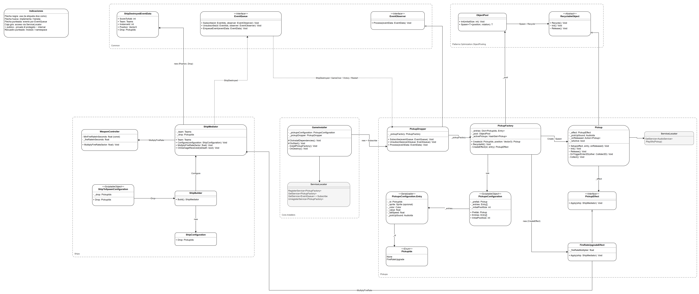

# Patrones de Diseño en Unity

Juego 2D de naves (disparos, oleadas de enemigos, jefe final, menús, leaderboard, pickups y audio) usado como ejercicio para aplicar **patrones de diseño** de creación, estructurales y de comportamiento sobre un mismo proyecto.

## Mapa de arquitectura

El diagrama muestra las clases del juego agrupadas por el patrón que ilustra cada una.

[](docs/mapa-de-arquitectura.png)

- Fuente editable: [Diagrama General.drawio](Assets/Patterns/Diagrama%20General.drawio)
- [Guía rápida de patrones (PDF)](Assets/Patterns/Guia_rapida_de_patrones.pdf)

### Sistema de Pickups

Añadido después del diagrama general: las naves enemigas pueden soltar mejoras que modifican a la nave que las recoge.

[](docs/mapa-pickups.png)

Fuente editable: [Diagrama Pickups.drawio](Assets/Patterns/Diagrama%20Pickups.drawio)

## Patrones utilizados

### Creación

| Patrón | Aplicación en el código |
|---|---|
| **Factory Method** | `ShipFactory`, `ProjectileFactory` y `PickupFactory` crean naves, proyectiles y pickups a partir de un identificador (`ShipId`, `ProjectileId`, `PickupIds`) y una configuración (`ScriptableObject`). |
| **Builder** | `ShipBuilder` construye una nave paso a paso (`WithPosition`, `WithRotation`, `FromPrefab`, `WithInput`, `Build`) con su `ShipConfiguration`. |
| **Singleton** | Ejemplo en `Assets/Patterns/Creation/Singleton`. En el juego se sustituyó por el Service Locator, que da el mismo acceso global pero sobre interfaces. |

### Estructurales

| Patrón | Aplicación en el código |
|---|---|
| **Adapter** | `UnityInputAdapter`, `JoystickInputAdapter` y `AIInputAdapter` adaptan teclado, joystick e IA a la interfaz `Input`. `PlayerPrefsDataStoreAdapter` adapta `PlayerPrefs` a `DataStore` y `JsonSerializerAdapater` adapta el JSON a `Serializer`. |
| **Facade** | `GameFacade` / `GameFacadeImpl` ofrece una entrada simple para iniciar y detener la batalla sin que el consumidor conozca los sistemas internos. |
| **Composite** | `CompositeCommand` agrupa varios comandos y los ejecuta como uno solo. El ejemplo está en `Assets/Patterns/Structural/Composite`; `LoadGameSceneCommand` encadena los comandos con `await` para que se ejecuten en orden. |

### Comportamiento

| Patrón | Aplicación en el código |
|---|---|
| **Strategy** | `CheckDestroyLimits` (`CheckBottomDestroyLimitsStrategy`, `DoNotCheckDestroyLimitsStrategy`), `CheckLimits` (`ViewportCheckLimits`, `InitialPositionCheckLimits`) y `PickupEffect` (`FireRateUpgradeEffect`) intercambian el comportamiento sin tocar a quien los usa. |
| **Template Method** | `Projectile` define el esqueleto (`DoStart`, `DoMove`) y `LinealProjectile`, `SinusoidalProjectile` y `CurveProjectile` rellenan los pasos. |
| **Mediator** | `ShipMediator` coordina `MovementController`, `WeaponController` y `HealthController`. `InGameMenuMediator` y `MainMenuMediator` desacoplan las vistas de los menús de las acciones. |
| **Observer + EventQueue** | `EventQueueImpl` recibe eventos (`ShipDestroyed`, `GameOver`, `Victory`, `Restart`…) y los reparte a los `EventObserver` suscritos, como `PickupDropper` y `AudioEventObserver`. |
| **State** | `GameStateController` cambia entre `PlayingState`, `GameOverState` y `VictoryState`. |
| **Command + CommandQueue** | Las acciones del juego son comandos (`LoadSceneCommand`, `StartBattleCommand`, `PauseGameCommand`, `ShowScreenFadeCommand`…) que se encolan y ejecutan en orden. |

### Desacoplamiento y optimización

| Patrón | Aplicación en el código |
|---|---|
| **Service Locator** | `ServiceLocator` registra servicios por interfaz (`EventQueue`, `ShipFactory`, `AudioService`, `ScoreSystem`…). Los `Installer` (`GlobalInstaller`, `GameInstaller`, `AudioInstaller`…) hacen de raíz de composición. |
| **Object Pool** | `ObjectPool` y `RecyclableObject` reutilizan proyectiles (`Projectile`), pickups (`Pickup`) y reproductores de efectos de sonido (`SfxPlayer`). |

## Estructura

```
Assets/
├── Code/                Código del juego
│   ├── Audio/           Música y efectos de sonido
│   ├── Battle/          GameFacade, GameStateController y estados
│   ├── Common/          Eventos, comandos y puntuación
│   ├── Core/            Installers, persistencia y serializadores
│   ├── Input/           Adapters de entrada
│   ├── Pickups/         Mejoras que sueltan los enemigos
│   ├── Ships/           Naves, armas, enemigos y configuración de niveles
│   └── UI/              Vistas y mediators de los menús
├── Patterns/            Ejemplos aislados de cada patrón y diagramas
└── Scenes/              Escenas del juego
docs/                    Imágenes de los mapas de arquitectura
```
